# Sobreprecios en compras del Estado

Herramienta local para detectar posibles sobreprecios en compras del Estado nacional argentino de bienes de
góndola (alimentos, limpieza, librería): compara lo que pagó el Estado en cada licitación con lo que costaba el
mismo producto en el mercado (mayoristas, supermercados, INDEC) en la misma fecha.

Corre en tu computadora (Windows o Mac), con una página web local y una base SQLite. No necesita servidores.

## Empezar (Windows, sin saber programar)

1. Instalá Python 3.12 → [guía con video](docs/guia_instalacion_windows.md)
2. Doble click en `instalar.bat`
3. Doble click en `configurar_claves.bat` (clave gratis de IA → [cómo sacarla](docs/guia_claves_api.md))
4. Doble click en `iniciar.bat` → se abre http://127.0.0.1:8000

Problemas: [preguntas frecuentes](docs/preguntas_frecuentes.md). Para seguir mejorando el sistema con IA:
[guía de Claude Code](docs/guia_claude_code.md).

## Qué hace

| Pantalla | Para qué |
|---|---|
| **Licitaciones** | Todas las compras analizadas, con semáforo, ordenadas por exceso estimado en pesos constantes (para comparar años distintos); filtros por producto, organismo, fechas, revisión y moneda |
| **Detalle de una licitación** | Síntesis (colores, monto total vs analizado, cobertura, qué falta para publicar), fechas de apertura/adjudicación/publicación, qué documento se importó y qué prueba, actos administrativos, ofertas (con las desestimadas y su causa) y, por renglón, por qué tiene ese color, la evidencia de mercado y la validación rápida ✓/✗/? |
| **Comprobante de cálculo** | Por renglón, imprimible: datos originales, cuenta del precio por kilo/litro, el par de cadenas que confirma el mínimo, IPC mes a mes, escenarios de plazo de pago, correcciones humanas |
| **Expediente para periodista** | Un HTML por licitación: resultados arriba; cómo se construyeron abajo (fuentes con URL, normalizaciones, inflación, supuestos, preguntas abiertas) |
| **Revisión** | Cola de casos a revisar (rojos, grises, equivalencias por verificar, montos que no cierran, errores del juez); en cada caso se corrigen producto, variedad, envase, precio o fecha, se descartan precios de mercado mal leídos y se completa el checklist de explicaciones alternativas; se recalcula en el lugar |
| **Analítica** | Organismos, productos, proveedores, procedimientos y meses con más brecha, con cobertura; montos en pesos de cada fecha, pesos constantes o dólares (contado con liqui) |
| **Producto** | Serie de precios: lo adjudicado por el Estado contra el mínimo de mercado de cada mes, en la moneda elegida |
| **Precios de programa** | Listas históricas de Precios Cuidados/Justos (2020-2023) con su texto original para validar ✓/✗ |
| **Impacto** | Qué cambió de color (y qué marcas "publicable" se revocaron) después de cada recálculo |
| **Empresas** | Adjudicatarios y su historia societaria (autoridades, socios, domicilios en el tiempo) |
| **Reportes** | Informes con metodología, límites y avisos (HTML, Excel, CSV) y los expedientes generados |
| **Datos y fuentes** | Actualizar la base (Boletín Oficial, COMPR.AR, precios de hoy, INDEC y dólar) en segundo plano; copia de seguridad y restauración sin consola |
| **＋ Investigar** | Analizar un caso puntual: link del BO o de COMPR.AR, número de proceso, texto o PDF |

Recorrido completo con capturas: ver **[Qué podés hacer, paso a paso](#qué-podés-hacer-paso-a-paso)** más abajo. Para
publicarla en internet (versión de solo lectura o con contraseña): [docs/despliegue_nube.md](docs/despliegue_nube.md).

## Qué podés hacer, paso a paso

Capturas de la base real (compras publicadas en el Boletín Oficial y COMPR.AR). Los nombres y CUIT de los
proveedores están reemplazados por "Proveedor A, B…": los colores de estas capturas **no pasaron por revisión
humana** y un color sin revisar no se publica al lado de un nombre.

**1. Ver qué compras tienen sobreprecio.** La lista de licitaciones, ordenada por exceso estimado en pesos
constantes, con filtros por producto, organismo, fechas y estado de revisión.

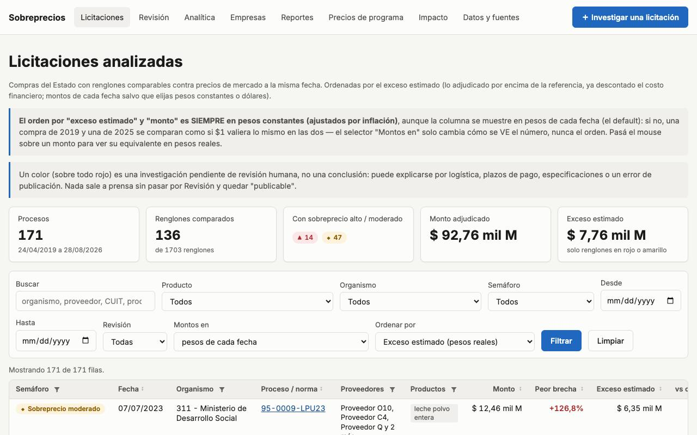

En las tablas principales, un click en el encabezado ordena la columna (números, fechas o texto; los vacíos
siempre al final) y las columnas de categorías (semáforo, organismo, proveedor, producto) tienen un filtro de
casillas con buscador. El filtro se mantiene al navegar sin recargar.

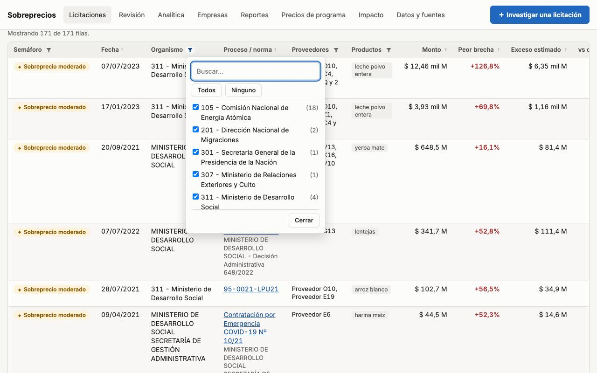

**2. Abrir una licitación.** Arriba la síntesis (colores, montos, cobertura y qué falta para publicar); abajo qué
documento se importó, las ofertas y, renglón por renglón, por qué tiene ese color.

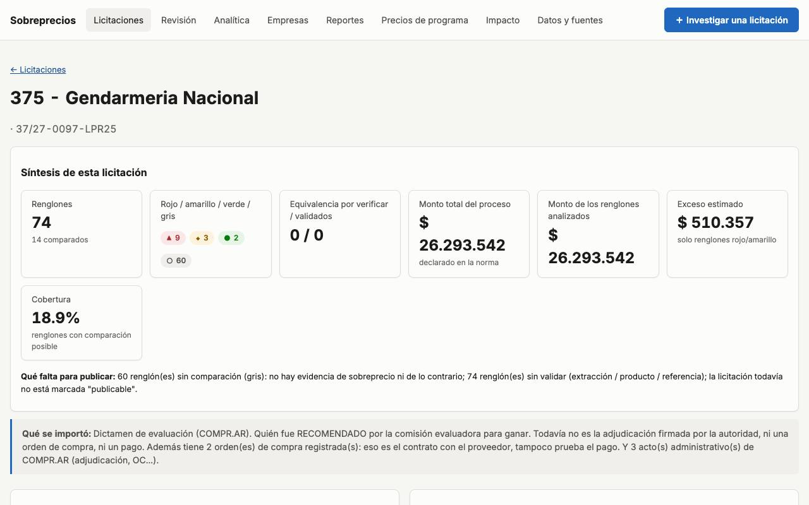

**3. Ver la cuenta completa de un renglón.** El comprobante imprimible: dato original, precio por kilo/litro,
referencia de mercado, ajuste por inflación y escenarios de plazo de pago.

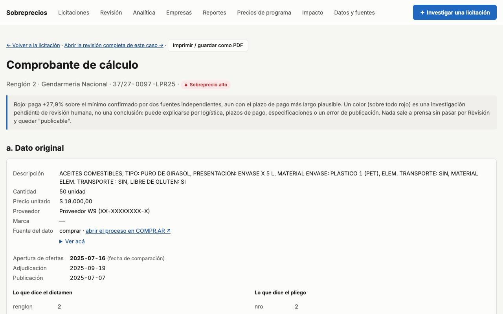

**4. Armar el expediente para un periodista.** Un HTML por licitación: resultados primero y después cómo se
construyeron (fuentes, normalizaciones, inflación, supuestos y preguntas abiertas).

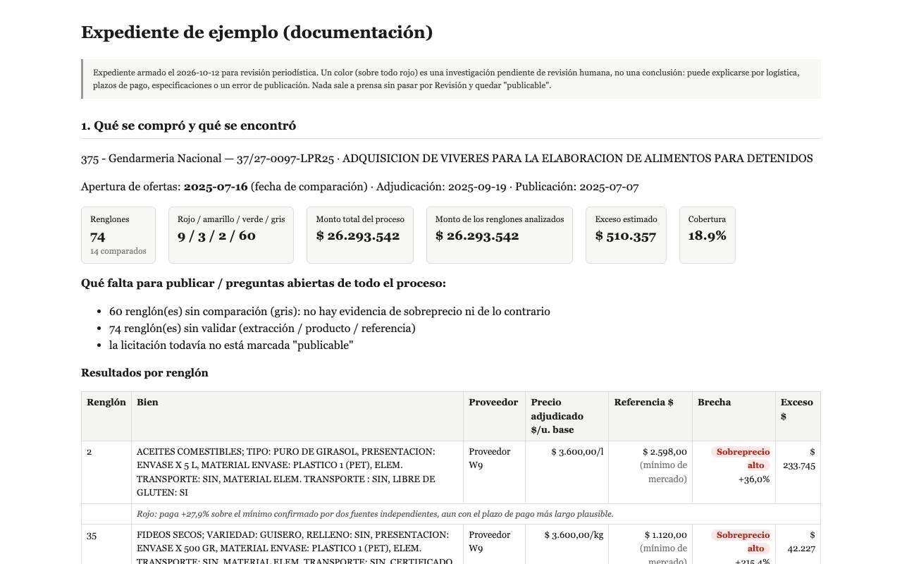

**5. Revisar los casos dudosos.** La cola de revisión: rojos, grises, equivalencias por verificar, montos que no
cierran y lo que marcó el juez externo.

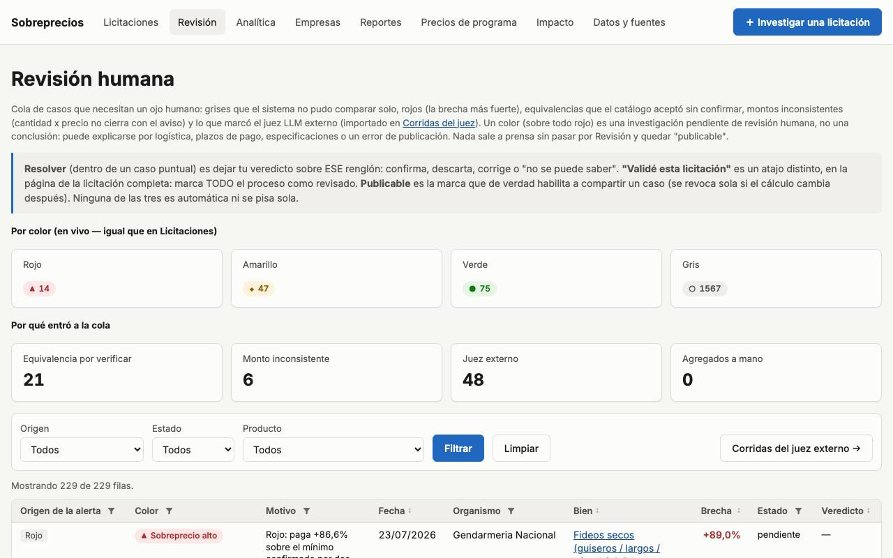

**6. Corregir un caso.** Producto, variedad, envase, precio o fecha; descartar un precio de mercado mal leído;
completar el checklist de explicaciones alternativas. Se recalcula en el lugar.

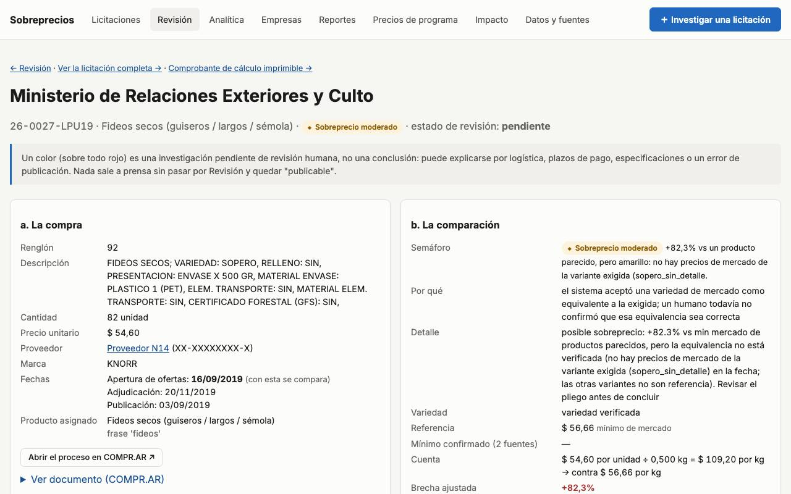

**7. Mirar el panorama.** Organismos, productos, proveedores y meses con más brecha, en pesos de cada fecha, pesos
constantes o dólares.

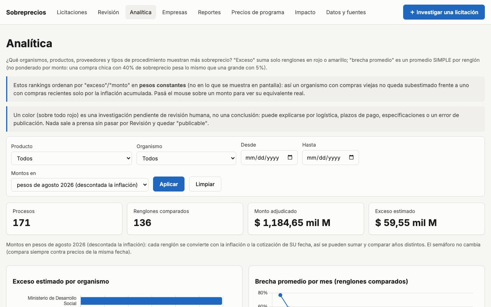

**8. Seguir un producto en el tiempo.** Lo que adjudicó el Estado en cada compra contra el mínimo de mercado de cada
mes.

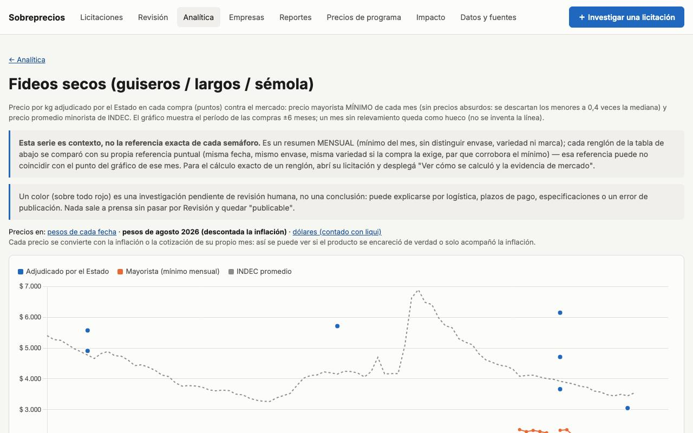

**9. Validar los precios de programa.** Las listas históricas de Precios Cuidados/Justos con su texto original, para
marcar ✓/✗ cada fila.

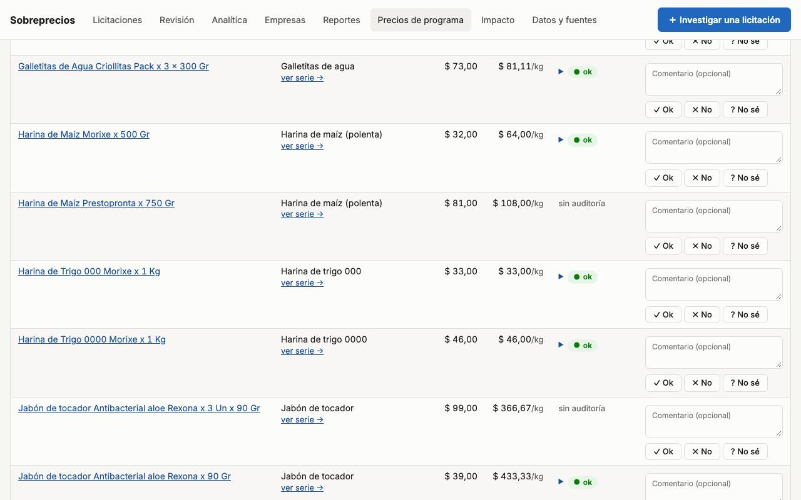

**10. Investigar un caso puntual.** Pegar un link del Boletín Oficial o de COMPR.AR, un número de proceso, el texto
de la norma o un PDF.

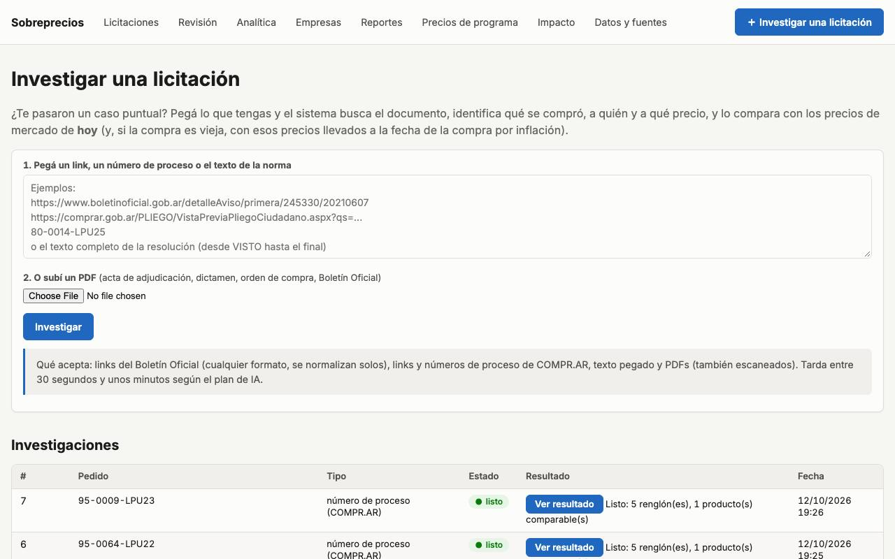

**11. Ver el impacto de un cambio.** Después de cada recálculo: qué renglones cambiaron de color o de exceso y qué
marcas "publicable" se revocaron.

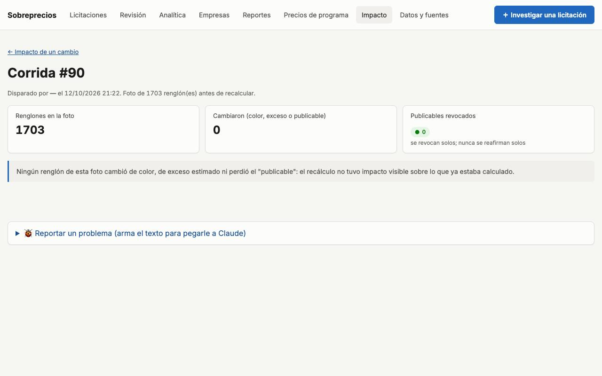

**12. Actualizar los datos.** Bajar avisos nuevos, precios de hoy, INDEC y dólar en segundo plano; copia de
seguridad y restauración sin consola.

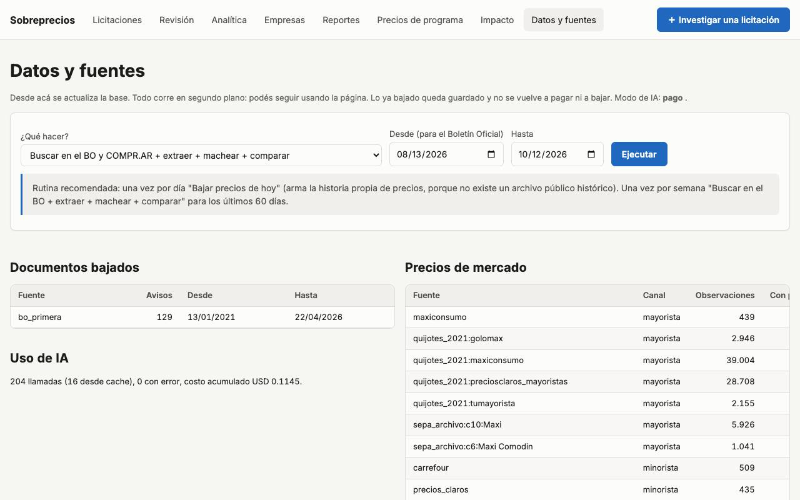

## Cómo se calcula (resumen)

- Cada precio se lleva a $/kg, $/litro o $/unidad y se compara solo contra el **mismo producto, variedad y envase**
  (catálogo en [config/productos.yml](config/productos.yml)). Si la compra no dice la variedad o el mercado no tiene
  ese producto en la fecha, queda gris: no se compara contra algo distinto.
- Referencia: la **misma marca** si la licitación la nombra; si no, el **mínimo de mercado** (supermercados y
  mayoristas), descartando precios absurdos. Si no hay NINGÚN precio real de mercado en la fecha, se usa como
  último recurso el precio de Precios Cuidados/Justos/Máximos (son un piso pactado, no el mínimo real): revisable
  a mano en "Precios de programa".
- Precios del día de la compra o anteriores (hasta 15 días), llevados al mes de la compra con el IPC.
- Semáforo: amarillo ≥ 8 % contra el mínimo observado (con 1 mes de plazo de pago descontado). **Rojo** ≥ 20 % contra el
  mínimo **confirmado por dos cadenas distintas**, aun suponiendo 2 meses de plazo. Diferencias > 4× se marcan
  "revisar unidad", nunca rojo. El promedio INDEC solo nunca da rojo.
- Montos de distintos años se pueden ver en **pesos reales** (descontada la inflación) o en **dólares** (contado con
  liqui del día) para sumarlos y compararlos.

**Una brecha no prueba una irregularidad.** Logística, plazos de pago, especificaciones o errores de publicación
pueden explicarla. Cada caso se revisa a mano antes de compartirlo (estado "publicable").

Detalle técnico y decisiones: [DESIGN_sobreprecios.md](DESIGN_sobreprecios.md).

Para una página pública con dominio propio, accesible desde cualquier celular (no solo
tu compu): guía paso a paso en [docs/despliegue_nube.md](docs/despliegue_nube.md).

## Línea de comandos

```bash
python -m sobreprecios.cli setup                  # base + catálogo + INDEC (+ dataset 2021 si está)
python -m sobreprecios.cli pipeline --desde 2026-01-01 --hasta 2026-09-30
python -m sobreprecios.cli precios-hoy            # una vez por día
python -m sobreprecios.cli precios-programa       # Precios Cuidados/Justos/Máximos (config/precios_programa.yml)
python -m sobreprecios.cli investigar "<link o número>"
python -m sobreprecios.cli servir --puerto 8000
python -m pytest -q                               # tests
```

## De dónde salen los precios y cómo se normalizan

Esta es la parte más importante para entender un número de la herramienta. Cada semáforo compara **dos precios por la
misma unidad** (pesos por kilo, por litro o por unidad): lo que el Estado adjudicó y lo más barato que había en el
mercado para el **mismo producto, la misma variedad y el mismo envase, en la misma fecha**.

### 1. El precio del Estado

| Fuente | Qué trae | Período | Qué prueba |
|---|---|---|---|
| Boletín Oficial, 1ª sección | Resoluciones que adjudican: proveedor, CUIT, cantidad, marca, precio unitario | 2019-2022 sobre todo | adjudicado |
| COMPR.AR (sitio público, sin login) | Renglones del pliego (código SIByS), cuadro comparativo con TODAS las ofertas, dictamen de evaluación, ofertas desestimadas con su causa, actos administrativos, órdenes de compra | 2018 en adelante | dictamen = recomendado · OC = contratado |

- Los textos del BO se leen con reglas y, si no alcanzan, con un modelo de IA barato (centavos por aviso); COMPR.AR se
  lee de sus tablas. Ningún dato dice "pagado": no hay fuente pública de pagos por renglón.
- La fecha con la que se compara es la **apertura de ofertas** (el proveedor fija el precio al ofertar); si no está, la
  adjudicación.

### 2. Qué producto es (normalización del producto)

- **Catálogo** de 34 productos de góndola ([config/productos.yml](config/productos.yml)): frases que lo identifican y
  frases que lo excluyen (descremada, saborizada, para mascotas, snacks, preparados...). Ajustes revisables aparte en
  [config/productos_ajustes.yml](config/productos_ajustes.yml).
- **Ficha SIByS**: en COMPR.AR cada renglón trae una clase de catálogo del Estado ("FIDEOS SECOS; VARIEDAD: TALLARIN...");
  solo se acepta un producto compatible con esa clase, y cada campo se lee por separado ("TIPO: CON PALO" no se
  confunde con un "SIN" de otro campo).
- **Variedad (atributo crítico)**: fideos por forma (tallarín ≠ spaghetti; "guisero" acepta cualquier forma corta),
  yerba con/sin palo, atún al aceite / al agua, puré ≠ salsa ≠ concentrado, etc. Si la compra no dice la variedad se
  usa la **común** cuando el equipo así lo decidió (leche en polvo entera común, sal común, dulce de leche en pote,
  pan dulce frutado...); si no, el caso queda gris para que lo complete un humano. La leche fortificada por Ley 25.459
  se compara con la leche en polvo común (no se vende al público) y se avisa.
- Lo que las reglas no resuelven lo clasifica un modelo de IA barato, **restringido a los productos del catálogo**.

### 3. Cuánto contiene (normalización de cantidades)

- Se lee el envase de cada descripción: gramos, kilos, cm³, mililitros, litros, unidades, packs ("6 x 1 l", "PAQ-500-gr.",
  "x 50 x 180 GR"); si la compra es por kilo o litro, el precio ya es por unidad base.
- **Precio por unidad base** = precio del envase ÷ contenido. En un pack se compara la unidad de adentro.
- Un envase de menos del 30 % del tamaño normal del producto no cuenta como ese producto (un "arroz" de 25 g es un
  condimento). Si el monto total del aviso no cierra con cantidad × precio, el renglón no puede ser rojo y se manda
  a revisión.

### 4. El precio de mercado, por período

| Período | Fuente | Tipo |
|---|---|---|
| 2016-2026 | INDEC, precios promedio GBA (~45 productos) | contexto; nunca da rojo sola |
| 2020-2023 | Listas de **Precios Cuidados / Justos** publicadas (PDF oficial, diarios, Wayback Machine) | se usa solo si no hay otro dato de esa fecha |
| 2021 | Dataset de Grupo Quijote: mayoristas (Maxiconsumo, Golomax, Tu Mayorista, Precios Claros) | mercado |
| ene-jul 2024 | Sin datos: **precio INFERIDO** desde agosto 2024 llevado hacia atrás con el IPC | rotulado, nunca rojo |
| ago-2024 en adelante | Archivo comunitario de los volcados oficiales **SEPA** (todas las cadenas grandes, por sucursal y código de barras) | mercado |
| desde hoy, cada día | Precios Claros, Carrefour, Maxiconsumo, espejo SEPA (`actualizar_datos.bat`) | mercado |

- **Cuarentena**: precios imposibles (un envase a $1, fideos de 2024 a $47, valores viejos sin actualizar) se apartan
  con su motivo: no se borran, pero no entran al cálculo. Precios de mercado mal leídos o de otro producto los puede
  descartar un humano desde la pantalla de Revisión.
- Precios de otro mes se llevan al mes de la compra con el **IPC** del INDEC (mes exacto; si falta, no se inventa).

### 5. La comparación y el semáforo

1. Para cada cadena se toma el precio de la fecha de la compra o el último anterior (hasta 15 días); uno posterior
   solo si no hay anterior, y no sirve para rojo.
2. Envase: si la licitación lo exige, solo ese envase (±3 %); si no, el **mínimo** entre envases parecidos.
3. **Referencia** = el mínimo de mercado (supermercados y mayoristas); si la licitación exige una marca (sin "o
   equivalente"), esa marca.
4. **Amarillo**: el Estado adjudicó ≥ 8 % por encima, descontando 1 mes de plazo de pago (inflación del mes).
5. **Rojo**: ≥ 20 % por encima del **mínimo confirmado por dos empresas distintas** (±5 % entre sí), aun suponiendo 2
   meses de plazo de pago. Un precio aislado ni crea ni borra un rojo.
6. **Gris**: no se puede comparar con honestidad (variedad desconocida, sin mercado de esa variedad o envase en la
   fecha, diferencia > 4 veces = revisar unidad). Si la brecha contra lo más parecido llega a rojo, queda
   **amarillo "equivalencia por verificar"** para que lo mire un humano.

### 6. Empresas, organismos y monedas

- Empresas unidas solo por **CUIT válido** (dígito verificador); "S.R.L." y "Sociedad de Responsabilidad Limitada" son
  lo mismo; sin CUIT, quedan como posibles. Autoridades y domicilios con fecha (Boletín Oficial, 2ª sección).
- Organismos con el **nombre que tenían a la fecha** (código SAF); los cambios de nombre se registran aparte.
- Montos en **pesos de cada fecha**, **pesos constantes** (IPC nivel general) o **dólares** (contado con liqui del día,
  ArgentinaDatos): cambia cómo se suman y comparan años distintos, no el semáforo.

### 7. Quién controla

Un juez de IA externo (más caro, de solo lectura) audita muestras; árboles de decisión por producto
([config/arboles_validacion.yml](config/arboles_validacion.yml)) guían la revisión; y **ningún caso sale sin que un
humano lo revise** en la pantalla de Revisión. Detalle técnico y fechas de cada decisión:
[DESIGN_sobreprecios.md](DESIGN_sobreprecios.md).

## Antecedente

Grupo Quijote (Calles, Madanes, Oks, Serebrennik), "Indicadores de Transparencia en
Argentina – El Precio de los Insumos Críticos que compra el Estado" (2021). Este proyecto reimplementa y extiende
esa metodología; su dataset 2021 se usa como caso de validación.

## Licencia

[MIT](LICENSE) — Copyright (c) 2026 Grupo Quijote. Se puede usar, copiar, modificar y redistribuir libremente,
manteniendo el aviso de copyright y la licencia. Chart.js (`sobreprecios/web/static/vendor/`) conserva su propia
licencia MIT.
